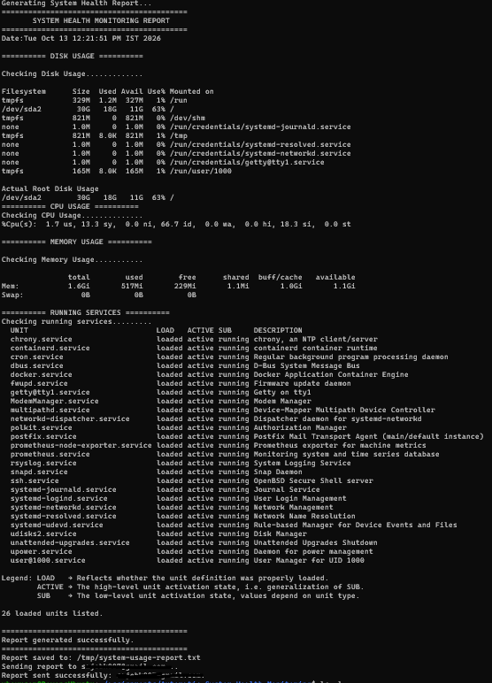
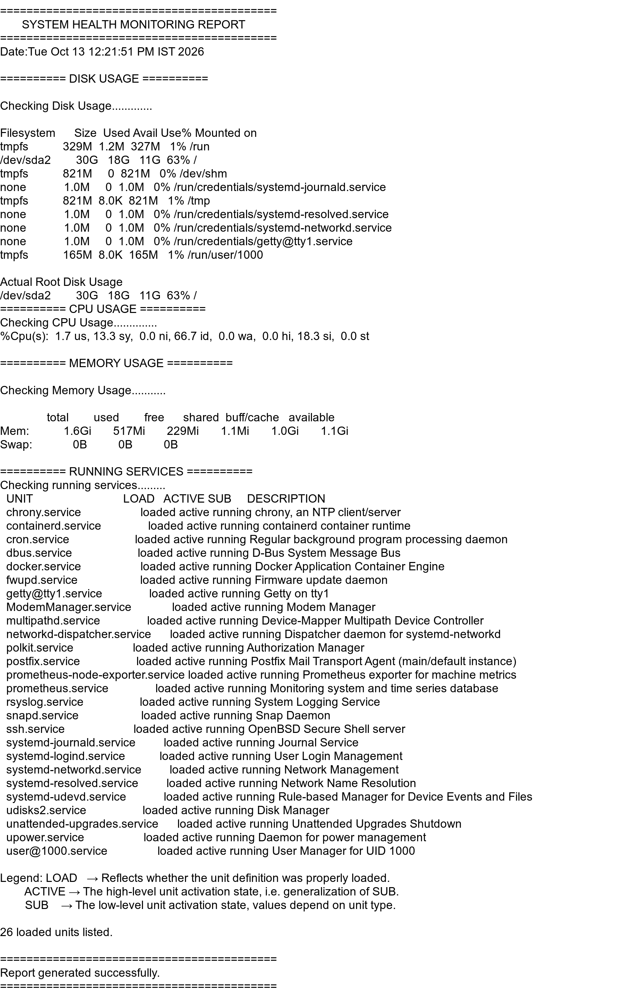

# Automated System Health Monitoring


A lightweight Bash tool that collects **disk, CPU, memory and running-service metrics** from a Linux machine, builds a formatted health report, and **emails it automatically** on a schedule using `cron`.
## Screenshots

<table>
  <tr>
    <th align="center">Terminal Output</th>
    <th align="center">Email Received</th>
  </tr>
  <tr>
    <td align="center">
      
    </td>
    <td align="center">
      
    </td>
  </tr>
</table>
No agents, no databases, no heavy dependencies - just standard Linux utilities.

---

## Table of Contents

- [Features](#features)
- [How It Works](#how-it-works)
- [Project Structure](#project-structure)
- [Prerequisites](#prerequisites)
- [Installation](#installation)
- [Configure Email](#configure-email)
- [Usage](#usage)
- [Automate with Cron](#automate-with-cron)
- [Sample Output](#sample-output)
- [Troubleshooting](#troubleshooting)
- [Roadmap](#roadmap)
- [Author](#author)

---

## Features

- **Disk usage** - `df -h` for all filesystems, plus a focused view of the root partition
- **CPU usage** - snapshot via `top -bn1`
- **Memory usage** - human-readable output via `free -h`
- **Running services** - lists active `systemd` services
- **Timestamped report** saved to `/tmp/system-usage-report.txt`
- **Email delivery** of the report using the `mail` command, with success/failure handling
- **Cron-ready** - runs unattended on any schedule
- Modular functions (`memory_usage`, `cpu_usage`, `disk_usage`, ...) that are easy to extend

## How It Works

```text
cron --> health.sh --> collect metrics (df, top, free, systemctl)
                              |
                              v
                 build report (/tmp/system-usage-report.txt)
                              |
                              v
                     send email via mail --> inbox
```

1. `cron` runs `health.sh` at the scheduled time.
2. Each function gathers one category of metrics.
3. `generate_report` combines everything into one report and writes it with `tee` (prints to terminal and saves to file).
4. `send_email` mails the report and reports success or failure.

## Project Structure

```
automated-system-health-monitoring/
├── health.sh          # Main monitoring script
├── crontab.example    # Ready-to-use cron schedule
├── screenshot/       # Terminal and email output screenshot
├── .gitignore
└── README.md
```

## Prerequisites

| Requirement | Purpose |
|---|---|
| Linux with `systemd` (Ubuntu / Debian / RHEL family) | `systemctl`, `free`, `top`, `df` |
| `bash` | Script interpreter |
| `cron` | Scheduling |
| `mailutils` (or `mailx`) + an MTA such as `postfix` or `msmtp` | Sending email |

## Installation

```bash
# 1. Clone the repository
git clone https://github.com/ksajeb/automated-system-health-monitoring.git
cd automated-system-health-monitoring

# 2. Make the script executable
chmod +x health.sh

# 3. Install mail support (Ubuntu/Debian)
sudo apt update
sudo apt install -y mailutils
```

## Configure Email

Open `health.sh` and set the recipient at the top of the file:

```bash
email_id="your-email@example.com"
```

For Gmail delivery, configure your MTA (for example `postfix` or `msmtp`) with an **App Password**. Never use your real account password and never commit credentials to the repository.

Test that mail works before scheduling:

```bash
echo "Test body" | mail -s "Test mail" your-email@example.com
```

## Usage

Run the script manually:

```bash
./health.sh
```

Expected console flow:

```
Generating System Health Report...
...report content...
Report saved to: /tmp/system-usage-report.txt
Sending report to your-email@example.com...
Report sent successfully: your-email@example.com.
```

## Automate with Cron

`cron` runs the script on a schedule so reports arrive without any manual step.

### 1. Find the absolute path of the script

```bash
realpath health.sh
# e.g. /home/ubuntu/automated-system-health-monitoring/health.sh
```

### 2. Open your crontab

```bash
crontab -e
```

### 3. Add a schedule

```cron
# Run the health check every day at 9:00 AM and log the output
0 9 * * * /home/ubuntu/automated-system-health-monitoring/health.sh >> /home/ubuntu/health-monitor.log 2>&1
```

Save and exit, then verify:

```bash
crontab -l
```

### Cron syntax cheat sheet

```
┌───────── minute        (0-59)
│ ┌─────── hour          (0-23)
│ │ ┌───── day of month  (1-31)
│ │ │ ┌─── month         (1-12)
│ │ │ │ ┌─ day of week   (0-7, Sun = 0 or 7)
│ │ │ │ │
* * * * *  command
```

| Schedule | Cron expression |
|---|---|
| Every hour | `0 * * * *` |
| Every 30 minutes | `*/30 * * * *` |
| Daily at 9 AM | `0 9 * * *` |
| Every Monday at 8 AM | `0 8 * * 1` |
| 1st of every month | `0 0 1 * *` |

A copy of the schedule lives in [`crontab.example`](./crontab.example). You can install it directly:

```bash
crontab crontab.example   # WARNING: replaces your existing crontab
```

### Verify cron is running

```bash
systemctl status cron          # Ubuntu / Debian
systemctl status crond         # RHEL / CentOS
grep CRON /var/log/syslog      # See recent cron executions
tail -f ~/health-monitor.log   # Watch script output
```

## Sample Output


### Screenshot

**Terminal output**


**Email received**


## Troubleshooting

| Problem | Fix |
|---|---|
| Script works manually but not in cron | Cron has a minimal `PATH`. Use **absolute paths** in the crontab and check the log file. |
| `mail: command not found` | Install it: `sudo apt install mailutils` |
| Email never arrives | Check `sudo tail -f /var/log/mail.log`, spam folder, and MTA configuration. |
| Root disk line is empty | The script greps `/dev/sda2`. Check your device with `df -h` and update the name in `disk_usage()`. |
| `Permission denied` | Run `chmod +x health.sh` |

## Roadmap

- [ ] Move the recipient email and root device to environment variables or a config file
- [ ] Log rotation and report history
- [ ] Check specific critical services (nginx, postgresql, docker)
- [ ] Slack / Telegram notifications
- [ ] Dockerized version and GitHub Actions ShellCheck lint

## Author

**Sajeb K** - [@ksajeb](https://github.com/ksajeb)

---

If you found this useful, consider giving the repo a star.


